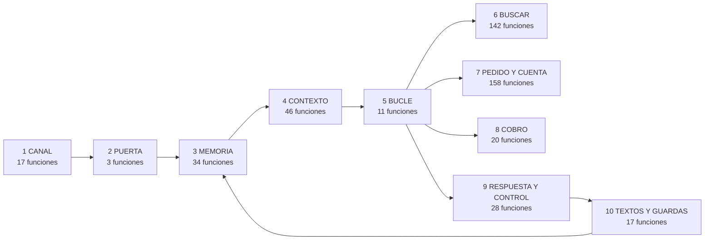

# DIAGRAMA DEL FLUJO — GENERADO, NO SE EDITA

Lo escribe `python3 banco_pruebas/diagrama.py` leyendo `app/`. `tests/test_diagrama.py` falla si una funcion queda sin caja o si este archivo no es el de hoy. Las cajas y sus reglas estan en `CAJAS` y `REGLAS`, en el script.

Limites: analisis estatico. Una referencia es un nombre que aparece en el codigo, no una llamada probada. Lo que se llama por `getattr`, o por texto, no se ve. Columna ALCANCE: `si` = alguna entrada la alcanza; `?` = ninguna la alcanza pero su nombre aparece escrito en otra parte de `app/`, hay que mirarla; `-` = ninguna la alcanza y su nombre no aparece en ningun otro lado de `app/`. Un `-` no prueba que sobre: puede usarla un script o un test.

Funciones y clases de nivel superior: 495. Entradas: `process_message`, `_declarar_config_efectiva`, `_precalentar_cache`, `health`, `health_tienda`, `root`, `telegram_webhook`, `upload_catalog`, `upload_faq`, `whatsapp_verify`, `whatsapp_webhook`

## Nivel 1 — el turno

Orden del turno: 1 CANAL, 2 PUERTA, 3 MEMORIA, 4 CONTEXTO, 5 BUCLE (el modelo llama 6 BUSCAR, 7 PEDIDO Y CUENTA y 8 COBRO), 9 RESPUESTA Y CONTROL, 10 TEXTOS Y GUARDAS, y vuelve a 3 para guardar.

- **1 CANAL**: el mensaje entra y la respuesta sale: webhooks de WhatsApp y Telegram, conectores, audio.
- **2 PUERTA**: antes del turno: anti-jailbreak y la palabra de reset.
- **3 MEMORIA**: cargar y guardar la charla: historial, memoria del agente, estado del pedido, Firestore.
- **4 CONTEXTO**: lo que ve el modelo: reglas, mapa de la tabla, lo que el cliente dijo, lo que la tienda no vende.
- **5 BUCLE**: la llamada al modelo, el despacho de sus herramientas y el armado final del turno.
- **6 BUSCAR**: el catalogo y la FAQ: la tabla con SQL, el motor, los filtros, la compatibilidad, los embeddings de temas.
- **7 PEDIDO Y CUENTA**: el pedido que vive en el codigo, la cuenta, el envio, el reparto del pago y el ejecutor heredado.
- **8 COBRO**: el link de pago, los datos de transferencia, el lead y el aviso al dueno.
- **9 RESPUESTA Y CONTROL**: la respuesta atada, el verificador y los controles de lo que el modelo omitio.
- **10 TEXTOS Y GUARDAS**: la prosa fija de la casa y las guardas de salida.

### El cableado real entre cajas

Cada celda cuenta cuantas funciones de la caja de la fila nombran a una funcion de la caja de la columna. Es lo que hace el codigo, no lo que dice el orden de arriba. Una celda debajo de la diagonal es una vuelta hacia atras.

| de \ a | 0 | 1 | 2 | 3 | 4 | 5 | 6 | 7 | 8 | 9 | 10 |
|---|---|---|---|---|---|---|---|---|---|---|---|
| **0** INFRA | · |  |  | 11 |  |  | 2 |  | 2 |  | 1 |
| **1** CANAL |  | · | 2 | 3 |  |  |  |  |  |  | 2 |
| **2** PUERTA |  |  | · | 2 |  |  |  |  | 1 |  | 1 |
| **3** MEMORIA |  |  |  | · |  | 1 | 3 | 1 |  |  | 3 |
| **4** CONTEXTO | 2 |  |  | 9 | · |  | 26 | 10 |  |  | 3 |
| **5** BUCLE | 4 |  |  |  | 8 | · | 4 | 7 | 1 | 7 | 1 |
| **6** BUSCAR | 1 |  |  | 23 | 8 |  | · | 7 |  |  | 6 |
| **7** PEDIDO Y CUENTA | 1 |  |  | 18 | 5 |  | 147 | · |  | 1 | 4 |
| **8** COBRO | 2 |  |  | 6 |  |  |  | 4 | · |  | 3 |
| **9** RESPUESTA Y CONTROL |  |  |  |  | 10 |  | 41 | 4 |  | · |  |
| **10** TEXTOS Y GUARDAS |  |  |  | 2 |  |  |  |  |  |  | · |

## Nivel 2 — cada caja

### 1 CANAL

El mensaje entra y la respuesta sale: webhooks de whatsapp y telegram, conectores, audio. 17 funciones, 449 lineas.

| modulo | funcion | lineas | nombrada desde las cajas | alcance |
|---|---|---|---|---|
| connectors.base | `partir_respuesta` | 18 | · | si |
| connectors.base | `enviar_respuesta` | 14 | · | si |
| connectors.base | `BaseConnector` (clase) | 12 | · | si |
| connectors.telegram | `TelegramConnector` (clase) | 64 | · | si |
| connectors.telegram | `get_telegram_connector` | 5 | · | si |
| connectors.whatsapp | `WhatsAppMetaConnector` (clase) | 63 | · | si |
| connectors.whatsapp | `get_whatsapp_connector_for_tienda` | 4 | · | si |
| connectors.whatsapp | `estados_de_whatsapp` | 15 | · | si |
| connectors.whatsapp | `parse_whatsapp_payload` | 33 | · | si |
| core.transcriber | `transcribir_audio` | 28 | · | si |
| main | `_prosa` | 6 | · | si |
| main | `_sobrecarga` | 6 | · | si |
| main | `_process_and_reply_telegram` | 41 | · | si |
| main | `telegram_webhook` | 25 | · | si |
| main | `_process_and_reply_whatsapp` | 47 | · | si |
| main | `whatsapp_verify` | 24 | · | si |
| main | `whatsapp_webhook` | 44 | · | si |

### 2 PUERTA

Antes del turno: anti-jailbreak y la palabra de reset. 3 funciones, 66 lineas.

| modulo | funcion | lineas | nombrada desde las cajas | alcance |
|---|---|---|---|---|
| core.antijailbreak | `_normalizar` | 5 | · | si |
| core.antijailbreak | `evaluar_mensaje` | 17 | · | si |
| core.orchestrator | `process_message` | 44 | 1 | si |

### 3 MEMORIA

Cargar y guardar la charla: historial, memoria del agente, estado del pedido, firestore. 34 funciones, 390 lineas.

| modulo | funcion | lineas | nombrada desde las cajas | alcance |
|---|---|---|---|---|
| core.contexto_turno | `set_current_tienda` | 3 | · | si |
| core.contexto_turno | `get_current_tienda` | 6 | 4,7,10 | si |
| core.contexto_turno | `tienda_por_defecto` | 17 | 6 | si |
| core.estado_venta | `set_current_estado` | 7 | · | - |
| core.estado_venta | `set_envio_localidad` | 9 | 7 | si |
| core.estado_venta | `get_envio_localidades` | 3 | 7 | si |
| core.estado_venta | `get_ids_certificados` | 3 | 7 | si |
| core.estado_venta | `get_current_estado` | 4 | 7 | si |
| core.flujo.agente | `memoria_de` | 3 | · | si |
| core.flujo.agente | `estado_de` | 15 | 4,7 | si |
| core.flujo.estado | `leer` | 6 | 6,7 | si |
| core.flujo.estado | `_de_antes` | 8 | · | si |
| core.flujo.estado | `mostrar` | 7 | 7 | si |
| core.flujo.turno | `procesar_turno` | 22 | 2 | si |
| storage.firestore_client | `_get_db` | 5 | · | si |
| storage.firestore_client | `_tienda_ref` | 4 | 8 | si |
| storage.firestore_client | `get_tienda_by_phone_id` | 24 | 1 | si |
| storage.firestore_client | `register_tienda` | 13 | · | - |
| storage.firestore_client | `get_all_products` | 35 | 0,6 | si |
| storage.firestore_client | `get_product_by_id` | 6 | 6,7 | si |
| storage.firestore_client | `get_categories` | 3 | 4 | si |
| storage.firestore_client | `upsert_product` | 4 | 0 | si |
| storage.firestore_client | `upsert_products_batch` | 31 | · | - |
| storage.firestore_client | `delete_all_products` | 18 | 0 | si |
| storage.firestore_client | `delete_all_faq` | 20 | 0 | si |
| storage.firestore_client | `invalidate_cache` | 15 | 0 | si |
| storage.firestore_client | `get_all_faq` | 22 | 0,4,6,7 | si |
| storage.firestore_client | `upsert_faq` | 5 | 0 | si |
| storage.firestore_client | `get_conversation` | 6 | · | si |
| storage.firestore_client | `save_conversation` | 31 | · | si |
| storage.firestore_client | `reset_conversation` | 13 | 2 | si |
| storage.firestore_client | `already_processed` | 15 | 1 | si |
| storage.firestore_client | `get_config` | 5 | 4,7,8,10 | si |
| storage.firestore_client | `set_config` | 2 | · | - |

### 4 CONTEXTO

Lo que ve el modelo: reglas, mapa de la tabla, lo que el cliente dijo, lo que la tienda no vende. 46 funciones, 655 lineas.

| modulo | funcion | lineas | nombrada desde las cajas | alcance |
|---|---|---|---|---|
| core.flujo.agente | `hoja_reglas` | 11 | 5 | si |
| core.flujo.agente | `charla` | 8 | 5 | si |
| core.flujo.agente | `memoria_texto` | 9 | 5 | si |
| core.flujo.marcador | `_numero` | 2 | · | si |
| core.flujo.marcador | `_modelo` | 2 | · | si |
| core.flujo.marcador | `_palabras` | 3 | · | si |
| core.flujo.marcador | `_propias` | 2 | · | si |
| core.flujo.marcador | `_productos` | 40 | 9 | si |
| core.flujo.marcador | `_rubros` | 18 | 9 | si |
| core.flujo.marcador | `_temas` | 28 | · | si |
| core.flujo.marcador | `marcar` | 22 | 7 | si |
| core.flujo.marcador | `vocabulario_respuestas` | 10 | 6,7 | si |
| core.flujo.marcador | `_sacar` | 8 | · | si |
| core.flujo.marcador | `_mismo` | 3 | · | si |
| core.flujo.marcador | `respuesta` | 37 | 7 | si |
| core.flujo.respuesta | `Citas` (clase) | 19 | 5,6,9 | si |
| core.flujo.respuesta | `orden_del_cliente` | 19 | 5 | si |
| core.flujo.tabla | `mapa` | 13 | 5 | si |
| core.flujo.tabla | `resumen` | 9 | 5 | si |
| core.fuente | `_norm` | 3 | · | si |
| core.fuente | `temas_consultables` | 8 | · | si |
| core.fuente | `_fichas` | 12 | · | si |
| core.fuente | `_senas_por_tema` | 16 | · | si |
| core.fuente | `certificar_tema` | 39 | · | si |
| core.fuente | `certificar_temas` | 21 | · | si |
| core.fuente | `_campos_prosa` | 3 | · | si |
| core.fuente | `_ficha_corta` | 44 | 6 | si |
| core.fuente | `_texto_del_tema` | 8 | · | si |
| core.fuente | `_criterio_del_tema` | 14 | · | si |
| core.fuente | `_de_la_casa` | 24 | · | si |
| core.fuente | `criterio_de` | 13 | 6 | si |
| core.fuente | `politicas_de` | 12 | 6,7 | si |
| core.fuente | `inventario` | 8 | · | ? |
| core.fuente | `_cotizar` | 11 | · | si |
| core.fuente | `_destino_legible` | 6 | · | si |
| core.fuente | `_destino_estable` | 7 | · | si |
| core.fuente | `_plazo_de` | 9 | · | si |
| core.fuente | `_umbral_de` | 5 | · | si |
| core.fuente | `_tabla_interior` | 12 | · | si |
| core.fuente | `_tarifas` | 14 | · | si |
| core.fuente | `_fila_de` | 11 | · | si |
| core.fuente | `cotizar_destinos` | 42 | 6 | si |
| core.guia_compra | `_norm` | 3 | · | si |
| core.guia_compra | `_singular` | 2 | · | si |
| core.guia_compra | `_no_vendidas` | 21 | · | si |
| core.guia_compra | `categoria_no_vendida` | 24 | 5,6 | si |

### 5 BUCLE

La llamada al modelo, el despacho de sus herramientas y el armado final del turno. 11 funciones, 242 lineas.

| modulo | funcion | lineas | nombrada desde las cajas | alcance |
|---|---|---|---|---|
| core.flujo.agente | `_llamar` | 10 | · | si |
| core.flujo.agente | `responder` | 153 | 3 | si |
| core.llm_reintento | `anotar_llamada_negada` | 4 | · | si |
| core.llm_reintento | `sin_cupo` | 3 | · | - |
| core.llm_reintento | `reiniciar_cupo` | 2 | · | - |
| core.llm_reintento | `es_transitorio` | 5 | · | si |
| core.llm_reintento | `espera_sugerida` | 9 | · | si |
| core.llm_reintento | `llamar_con_reintento` | 34 | · | si |
| core.llm_reintento | `_settings` | 3 | · | si |
| core.llm_reintento | `_cliente` | 14 | · | si |
| core.llm_reintento | `_modelo` | 5 | · | si |

### 6 BUSCAR

El catalogo y la faq: la tabla con sql, el motor, los filtros, la compatibilidad, los embeddings de temas. 142 funciones, 2765 lineas.

| modulo | funcion | lineas | nombrada desde las cajas | alcance |
|---|---|---|---|---|
| core.agente | `_trace` | 2 | · | si |
| core.agente | `_n` | 3 | · | si |
| core.agente | `_tokens` | 3 | · | si |
| core.agente | `_alias` | 10 | 4,7 | si |
| core.agente | `indice` | 29 | 4,7 | si |
| core.agente | `ubicar` | 12 | · | si |
| core.agente | `_rubro` | 10 | · | si |
| core.agente | `_motor` | 3 | · | si |
| core.agente | `h_envio` | 4 | · | si |
| core.agente | `h_compatibilidad` | 3 | · | si |
| core.agente | `h_cuenta` | 12 | · | si |
| core.agente | `ejecutar` | 9 | 7 | si |
| core.coherencia_datos | `_ruta` | 4 | · | si |
| core.coherencia_datos | `_filas` | 6 | · | si |
| core.coherencia_datos | `_clave` | 3 | · | si |
| core.coherencia_datos | `_choca` | 11 | · | si |
| core.coherencia_datos | `modelo_contra_planilla` | 15 | · | si |
| core.coherencia_datos | `prosa_despues_de_ingerir` | 15 | · | si |
| core.coherencia_datos | `compat_fuera_de_vocabulario` | 19 | · | si |
| core.coherencia_datos | `compat_contra_specs` | 22 | · | si |
| core.coherencia_datos | `_modelos_del_catalogo` | 2 | · | si |
| core.coherencia_datos | `filas_huerfanas` | 12 | · | si |
| core.coherencia_datos | `columnas_no_declaradas` | 12 | · | si |
| core.coherencia_datos | `revisar_todo` | 4 | 0 | si |
| core.compatibilidad | `_ruta` | 14 | · | si |
| core.compatibilidad | `vocabulario` | 44 | · | si |
| core.compatibilidad | `tabla` | 43 | · | si |
| core.compatibilidad | `va_adentro` | 6 | 7 | si |
| core.compatibilidad | `compat_de` | 10 | · | si |
| core.compatibilidad | `plataformas_del_mensaje` | 17 | 7,9 | si |
| core.compatibilidad | `conectores_del_mensaje` | 9 | 7 | si |
| core.compatibilidad | `por_conector` | 18 | · | si |
| core.compatibilidad | `choca_con_lo_dicho` | 16 | · | si |
| core.compatibilidad | `etiqueta_plataforma` | 3 | 7,9 | si |
| core.compatibilidad | `etiqueta_conector` | 3 | · | si |
| core.compatibilidad | `evaluar` | 22 | 9 | si |
| core.compatibilidad | `evaluar_par` | 58 | · | si |
| core.curadas | `_fmt_valor` | 22 | · | si |
| core.curadas | `estampar_valores` | 21 | 4 | si |
| core.filtros_catalogo | `_norm` | 3 | 7 | si |
| core.filtros_catalogo | `_derivado` | 7 | · | si |
| core.filtros_catalogo | `_valor_crudo` | 7 | 7 | si |
| core.filtros_catalogo | `_si_no` | 6 | · | si |
| core.filtros_catalogo | `recorrida` | 91 | 4 | si |
| core.filtros_catalogo | `_sumar_valor` | 12 | · | si |
| core.filtros_catalogo | `vocabulario` | 26 | · | si |
| core.filtros_catalogo | `condicion_sin_vocabulario` | 16 | · | si |
| core.filtros_catalogo | `campos_filtrables` | 4 | 7,9 | si |
| core.filtros_catalogo | `limpiar_cache` | 11 | 3 | si |
| core.filtros_catalogo | `_a_numero` | 7 | · | si |
| core.filtros_catalogo | `_raices` | 4 | · | si |
| core.filtros_catalogo | `_texto_contiene` | 10 | · | si |
| core.filtros_catalogo | `evaluar` | 29 | · | si |
| core.filtros_catalogo | `_pega_por_raiz` | 6 | · | si |
| core.filtros_catalogo | `_preferencia_numerica` | 21 | · | si |
| core.filtros_catalogo | `_ordenar_por_preferencia` | 12 | · | si |
| core.filtros_catalogo | `campos_con_el_valor` | 10 | · | si |
| core.filtros_catalogo | `_donde_si_vive` | 9 | · | si |
| core.filtros_catalogo | `aplicar` | 110 | · | si |
| core.filtros_catalogo | `_texto_del_producto` | 14 | · | si |
| core.filtros_catalogo | `relevancia` | 15 | · | si |
| core.filtros_catalogo | `_frase_corta` | 12 | · | si |
| core.filtros_catalogo | `palabras_utiles` | 9 | · | si |
| core.filtros_catalogo | `palabras_de_identidad` | 15 | · | si |
| core.filtros_catalogo | `pesos_por_rareza` | 18 | · | si |
| core.filtros_catalogo | `lo_nombra` | 13 | · | si |
| core.filtros_catalogo | `alguno_lo_nombra` | 3 | · | si |
| core.filtros_catalogo | `los_que_lo_nombran_entero` | 15 | · | si |
| core.filtros_catalogo | `clave_de_orden` | 12 | · | si |
| core.filtros_catalogo | `orden_tiene_sentido` | 9 | · | si |
| core.filtros_catalogo | `ordenar` | 14 | · | si |
| core.filtros_catalogo | `cuantos_cumple` | 13 | · | si |
| core.filtros_catalogo | `rankear_por_cercania` | 14 | · | si |
| core.filtros_catalogo | `dato_que_falla` | 24 | · | si |
| core.flujo.agente | `_agenda` | 2 | 7 | si |
| core.flujo.agente | `_vectores` | 20 | · | si |
| core.flujo.agente | `_base` | 9 | · | si |
| core.flujo.agente | `_parecidos` | 15 | · | si |
| core.flujo.agente | `_lugares` | 3 | 7,9 | si |
| core.flujo.agente | `_orden_de` | 5 | 9 | si |
| core.flujo.agente | `_tema_por_clave` | 7 | · | si |
| core.flujo.agente | `buscar` | 27 | 5 | si |
| core.flujo.catalogo | `n` | 3 | 4,5,7,9 | si |
| core.flujo.catalogo | `productos` | 2 | 4,7,9 | si |
| core.flujo.catalogo | `rubro` | 3 | 7 | si |
| core.flujo.catalogo | `solo_rubro` | 6 | 7 | si |
| core.flujo.catalogo | `con_stock` | 2 | 7,9 | si |
| core.flujo.catalogo | `entero` | 6 | 3,4,5,7 | si |
| core.flujo.catalogo | `_colores_de` | 4 | 4,7,9 | si |
| core.flujo.catalogo | `identificar` | 15 | 4,7,9 | si |
| core.flujo.catalogo | `_identificar` | 34 | · | si |
| core.flujo.catalogo | `por_id` | 2 | 7 | si |
| core.flujo.catalogo | `_valores` | 8 | · | si |
| core.flujo.catalogo | `_pistas_derivadas` | 8 | · | si |
| core.flujo.catalogo | `_si_no_nombrado` | 10 | 9 | si |
| core.flujo.catalogo | `_contiene` | 5 | · | si |
| core.flujo.catalogo | `_monto` | 8 | 4 | si |
| core.flujo.catalogo | `atar` | 39 | 4,7,9 | si |
| core.flujo.catalogo | `cumple` | 14 | 7,9 | si |
| core.flujo.catalogo | `buscar` | 30 | 7 | si |
| core.flujo.tabla | `_columnas` | 20 | · | si |
| core.flujo.tabla | `tabla` | 14 | 4,9 | si |
| core.flujo.tabla | `es_consulta` | 2 | 5 | si |
| core.flujo.tabla | `columnas` | 2 | 4,9 | si |
| core.flujo.tabla | `ficha` | 5 | 9 | si |
| core.flujo.tabla | `con_orden` | 7 | · | si |
| core.flujo.tabla | `consultar` | 51 | · | si |
| core.fuente_producto | `_norm` | 3 | · | si |
| core.fuente_producto | `_patron_clave` | 7 | · | si |
| core.fuente_producto | `_ruta_config` | 15 | · | si |
| core.fuente_producto | `specs_config` | 60 | · | si |
| core.fuente_producto | `_ruta_dato` | 14 | · | si |
| core.fuente_producto | `specs_por_categoria` | 22 | · | si |
| core.fuente_producto | `specs_por_modelo` | 23 | · | si |
| core.fuente_producto | `aplica` | 5 | · | si |
| core.fuente_producto | `campos_ficha` | 6 | 4 | si |
| core.fuente_producto | `_tokens` | 2 | · | si |
| core.fuente_producto | `depurar_ficha` | 21 | · | si |
| core.fuente_producto | `_valores_de` | 15 | · | si |
| core.fuente_producto | `purgar_prosa_contradicha` | 59 | · | si |
| core.fuente_producto | `extraer_specs` | 29 | · | si |
| core.fuente_producto | `_completar_capas` | 28 | · | si |
| core.fuente_producto | `valor_numerico` | 12 | · | si |
| core.fuente_producto | `derivar_tags` | 10 | · | si |
| core.fuente_producto | `normalizar_producto` | 24 | 0 | si |
| core.fuente_producto | `_compat_de` | 8 | · | si |
| core.fuente_producto | `enriquecer` | 32 | 3 | si |
| core.huecos | `anotar` | 7 | · | si |
| core.motor | `_Cond` (clase) | 9 | · | si |
| core.motor | `_equipos` | 12 | · | si |
| core.motor | `_universo` | 10 | · | si |
| core.motor | `_por_ids` | 6 | · | si |
| core.motor | `_con_la_cuenta` | 29 | · | si |
| core.motor | `_la_cuenta` | 92 | · | si |
| core.motor | `_certificar_id` | 36 | · | si |
| core.motor | `_no_vendemos` | 20 | · | si |
| core.motor | `_una` | 248 | · | si |
| core.motor | `_salida` | 19 | · | si |
| core.motor | `_una_afirmacion` | 67 | · | si |
| core.motor | `_un_compat` | 64 | · | si |
| core.motor | `_evaluar` | 42 | · | si |
| core.motor | `buscar` | 189 | · | si |

### 7 PEDIDO Y CUENTA

El pedido que vive en el codigo, la cuenta, el envio, el reparto del pago y el ejecutor heredado. 158 funciones, 3403 lineas.

| modulo | funcion | lineas | nombrada desde las cajas | alcance |
|---|---|---|---|---|
| core.calc_defensiva | `normalizar_inputs` | 48 | · | si |
| core.calculadora | `_efecto_porcentaje` | 14 | · | si |
| core.calculadora | `_money` | 6 | 3,4,6 | si |
| core.calculadora | `_label_extra` | 33 | · | si |
| core.calculadora | `_render_presentacion` | 17 | · | si |
| core.calculadora | `_subtotales_por_grupo` | 39 | · | si |
| core.calculadora | `calculate_total` | 451 | 6 | si |
| core.calculadora | `_umbral_envio_gratis` | 13 | 4 | si |
| core.calculadora | `cotizar_envio` | 163 | 4,6 | si |
| core.envio | `_norm` | 7 | · | si |
| core.envio | `_cp_solo` | 7 | · | si |
| core.envio | `_zona_por_4digitos` | 9 | · | si |
| core.envio | `_zona_por_provincia` | 12 | · | si |
| core.envio | `_zona_por_nombre` | 41 | · | si |
| core.envio | `_provincia_por_cp4` | 8 | · | si |
| core.envio | `clasificar_provincia` | 52 | · | si |
| core.envio | `clasificar_zona` | 61 | · | si |
| core.flujo.agenda | `palabras` | 3 | · | si |
| core.flujo.agenda | `preguntas` | 3 | · | si |
| core.flujo.agente | `_visto` | 6 | · | si |
| core.flujo.agente | `menciones` | 32 | 9 | si |
| core.flujo.agente | `medios_de_la_tienda` | 12 | 9 | si |
| core.flujo.agente | `no_lo_toma` | 4 | 9 | si |
| core.flujo.agente | `de_la_oferta` | 18 | 5 | si |
| core.flujo.agente | `_reparto` | 25 | 8 | si |
| core.flujo.agente | `medios_rechazados` | 3 | 8 | si |
| core.flujo.agente | `procedencia` | 29 | · | si |
| core.flujo.agente | `por_lo_mostrado` | 11 | · | si |
| core.flujo.agente | `pedido` | 58 | 5,8 | si |
| core.flujo.agente | `_con_descuento` | 5 | · | si |
| core.flujo.agente | `presupuesto` | 106 | 5,8 | si |
| core.flujo.agente | `calcular` | 10 | 5 | si |
| core.flujo.agente | `_pegado` | 3 | 5 | si |
| core.flujo.agente | `_id_de` | 2 | 5 | si |
| core.flujo.agente | `_por_rubro` | 4 | 9 | si |
| core.flujo.borrador | `leer` | 3 | 4 | si |
| core.flujo.borrador | `_destino` | 3 | · | si |
| core.flujo.borrador | `_mismo_destino` | 4 | · | si |
| core.flujo.borrador | `_cantidad` | 2 | · | si |
| core.flujo.borrador | `_por_L` | 2 | · | si |
| core.flujo.borrador | `anotar_busqueda` | 4 | · | si |
| core.flujo.borrador | `aplicar` | 76 | · | si |
| core.flujo.borrador | `_art` | 3 | · | si |
| core.flujo.borrador | `resolver` | 14 | 4 | si |
| core.flujo.borrador | `_resolver` | 102 | · | si |
| core.flujo.borrador | `base` | 5 | · | si |
| core.flujo.borrador | `_ejes` | 18 | · | si |
| core.flujo.borrador | `_leer` | 14 | · | si |
| core.flujo.borrador | `en_palabras` | 10 | · | si |
| core.flujo.borrador | `_y` | 2 | · | si |
| core.flujo.borrador | `todas` | 18 | · | si |
| core.flujo.borrador | `_cierra` | 8 | · | si |
| core.flujo.borrador | `_proponer` | 42 | · | si |
| core.flujo.borrador | `_combo` | 3 | · | si |
| core.flujo.borrador | `elegir` | 6 | · | si |
| core.flujo.borrador | `aceptar` | 7 | · | si |
| core.flujo.borrador | `faltantes` | 20 | 4 | si |
| core.flujo.borrador | `pago_listo` | 6 | · | si |
| core.flujo.borrador | `articulos` | 11 | · | si |
| core.flujo.borrador | `huella` | 3 | · | si |
| core.flujo.borrador | `etapa` | 9 | · | si |
| core.flujo.borrador | `_que` | 4 | · | si |
| core.flujo.borrador | `preguntas` | 2 | · | si |
| core.flujo.borrador | `_pregunta` | 36 | · | si |
| core.flujo.borrador | `esperas` | 19 | · | si |
| core.flujo.borrador | `libreta` | 27 | 4 | si |
| core.flujo.ejecutor | `_lista` | 2 | · | si |
| core.flujo.ejecutor | `_si` | 2 | · | si |
| core.flujo.ejecutor | `_modelo` | 5 | · | si |
| core.flujo.ejecutor | `_modelo_de` | 2 | · | si |
| core.flujo.ejecutor | `_no_achica` | 4 | · | si |
| core.flujo.ejecutor | `Turno` (clase) | 246 | · | si |
| core.flujo.ejecutor | `_valor_de` | 6 | · | si |
| core.flujo.ejecutor | `_campo_de` | 22 | · | si |
| core.flujo.ejecutor | `_frases_de_campos` | 9 | · | si |
| core.flujo.ejecutor | `_oracion` | 8 | · | si |
| core.flujo.ejecutor | `_perdidos` | 8 | · | si |
| core.flujo.ejecutor | `_nombres` | 15 | · | si |
| core.flujo.ejecutor | `_uno` | 10 | · | si |
| core.flujo.ejecutor | `_sin_n` | 2 | · | si |
| core.flujo.ejecutor | `_producto` | 10 | · | si |
| core.flujo.ejecutor | `_buscar` | 2 | · | si |
| core.flujo.ejecutor | `_compatibilidad` | 42 | · | si |
| core.flujo.ejecutor | `_veredicto` | 5 | · | si |
| core.flujo.ejecutor | `_politica` | 12 | · | si |
| core.flujo.ejecutor | `_reparto` | 11 | · | si |
| core.flujo.ejecutor | `_supuestos` | 2 | · | si |
| core.flujo.ejecutor | `_acepta` | 11 | · | si |
| core.flujo.ejecutor | `_cambia` | 2 | · | si |
| core.flujo.ejecutor | `_solo_si` | 9 | · | si |
| core.flujo.ejecutor | `_el_que_cumple` | 24 | · | si |
| core.flujo.ejecutor | `_comprar` | 34 | · | si |
| core.flujo.ejecutor | `_cuenta` | 44 | · | si |
| core.flujo.ejecutor | `_envio` | 3 | · | si |
| core.flujo.ejecutor | `_explicar` | 2 | · | si |
| core.flujo.ejecutor | `_otro` | 8 | · | si |
| core.flujo.ejecutor | `_cumplir` | 20 | · | si |
| core.flujo.ejecutor | `ejecutar` | 80 | 6 | si |
| core.flujo.ejecutor | `_palabras_de` | 3 | · | si |
| core.flujo.ejecutor | `atar_esperas` | 17 | · | si |
| core.flujo.ejecutor | `_llenar` | 7 | · | si |
| core.flujo.ejecutor | `_atar_respuesta` | 29 | · | si |
| core.flujo.ejecutor | `_atar_equipo` | 42 | · | si |
| core.flujo.ejecutor | `_derivar` | 26 | · | si |
| core.flujo.interprete | `datos` | 10 | · | ? |
| core.flujo.interprete | `numeros` | 16 | · | si |
| core.flujo.normal | `_lista` | 2 | · | si |
| core.flujo.normal | `_es` | 2 | · | si |
| core.flujo.normal | `lugares` | 26 | 6 | si |
| core.flujo.normal | `_Ctx` (clase) | 21 | · | si |
| core.flujo.normal | `si_sin_efecto` | 18 | · | si |
| core.flujo.normal | `precio_con_envio` | 9 | · | si |
| core.flujo.normal | `politica_de_envio_con_lugar` | 22 | · | si |
| core.flujo.normal | `envio_a_varios` | 13 | · | si |
| core.flujo.normal | `un_destino_para_el_pedido` | 22 | · | si |
| core.flujo.normal | `cuenta_de_lo_buscado` | 19 | · | si |
| core.flujo.normal | `cuenta_de_lo_nombrado` | 18 | · | si |
| core.flujo.normal | `lista_con_dato` | 33 | · | si |
| core.flujo.normal | `rubro_inventado` | 11 | · | si |
| core.flujo.normal | `dato_del_producto` | 18 | · | si |
| core.flujo.normal | `_campo` | 4 | · | si |
| core.flujo.normal | `referencias_cruzadas` | 36 | · | si |
| core.flujo.normal | `el_pedido_sin_pedido` | 9 | · | si |
| core.flujo.normal | `color_ajeno` | 26 | · | si |
| core.flujo.normal | `compatibilidad_de_un_rubro` | 18 | · | si |
| core.flujo.normal | `un_medio_es_todo` | 9 | · | si |
| core.flujo.normal | `_casi` | 12 | · | si |
| core.flujo.normal | `_frase_en` | 9 | · | si |
| core.flujo.normal | `orden_que_no_dijo` | 22 | · | si |
| core.flujo.normal | `lo_corregido` | 13 | · | si |
| core.flujo.normal | `rubro_con_marca` | 24 | · | si |
| core.flujo.normal | `alternativa_compatible` | 18 | · | si |
| core.flujo.normal | `producto_del_envio` | 24 | · | si |
| core.flujo.normal | `compra_si_sale` | 23 | · | si |
| core.flujo.normal | `_numerar` | 8 | · | si |
| core.flujo.normal | `normalizar` | 12 | · | si |
| core.flujo.redaccion | `_otros_colores` | 6 | · | si |
| core.flujo.redaccion | `_fila` | 2 | · | si |
| core.flujo.redaccion | `_etiqueta` | 6 | · | si |
| core.flujo.redaccion | `_producto` | 12 | · | si |
| core.flujo.redaccion | `_lista` | 19 | · | si |
| core.flujo.redaccion | `_cuenta` | 5 | · | si |
| core.flujo.redaccion | `_envio` | 7 | · | si |
| core.flujo.redaccion | `pedir_nombre` | 3 | 5 | si |
| core.flujo.redaccion | `texto` | 15 | 6 | si |
| core.geo_cp | `_norm` | 5 | · | si |
| core.geo_cp | `_cargar` | 26 | · | si |
| core.geo_cp | `_provincia_en_texto` | 17 | · | si |
| core.geo_cp | `_localidades_en_texto` | 20 | · | si |
| core.geo_cp | `_por_prefijo` | 22 | · | si |
| core.geo_cp | `es_lugar_conocido` | 9 | · | si |
| core.geo_cp | `resolver` | 34 | · | si |
| core.pago_split | `_palabras` | 2 | · | si |
| core.pago_split | `lleva_descuento` | 3 | · | si |
| core.pago_split | `_money` | 2 | · | si |
| core.pago_split | `descuento_de` | 13 | · | si |
| core.pago_split | `calcular_split` | 48 | · | si |
| core.pago_split | `render_split` | 16 | · | si |

### 8 COBRO

El link de pago, los datos de transferencia, el lead y el aviso al dueno. 20 funciones, 387 lineas.

| modulo | funcion | lineas | nombrada desde las cajas | alcance |
|---|---|---|---|---|
| core.flujo.agente | `cobrar` | 43 | 5 | si |
| core.leads | `_pregunta_cierre` | 4 | · | si |
| core.leads | `_normalizar_modo` | 4 | · | si |
| core.leads | `modo_cierre` | 12 | 0 | si |
| core.leads | `descartar_leads_activos` | 24 | 2 | si |
| core.leads | `crear_lead` | 28 | · | si |
| core.leads | `actualizar_lead` | 3 | · | si |
| core.notificador | `notificar_lead` | 90 | · | si |
| core.pago | `_pago_parcial` | 4 | · | si |
| core.pago | `montos_por_medio` | 13 | · | si |
| core.pago | `monto_a_cobrar` | 12 | · | si |
| core.pago | `extraer_total_verificado` | 15 | · | si |
| core.pago | `_token` | 8 | · | si |
| core.pago | `crear_link_pago` | 32 | · | si |
| core.pago | `link_pago_para_lead` | 18 | · | si |
| core.pago | `_money` | 6 | · | si |
| core.pago | `elegir_medio_pago` | 13 | · | si |
| core.pago | `datos_transferencia` | 17 | · | si |
| core.pago | `mensaje_transferencia` | 22 | · | si |
| core.pago | `instruccion_cobro` | 19 | · | si |

### 9 RESPUESTA Y CONTROL

La respuesta atada, el verificador y los controles de lo que el modelo omitio. 28 funciones, 394 lineas.

| modulo | funcion | lineas | nombrada desde las cajas | alcance |
|---|---|---|---|---|
| core.flujo.agente | `destinos_dichos` | 6 | 7 | si |
| core.flujo.agente | `sin_buscar` | 14 | 5 | si |
| core.flujo.agente | `omitidos` | 44 | 5 | si |
| core.flujo.respuesta | `_A` | 3 | · | si |
| core.flujo.respuesta | `herramienta_responder` | 17 | 5 | si |
| core.flujo.respuesta | `_voces` | 18 | · | si |
| core.flujo.respuesta | `datos_en_libre` | 16 | 5 | si |
| core.flujo.respuesta | `_valor` | 8 | · | si |
| core.flujo.respuesta | `_corto` | 7 | · | si |
| core.flujo.respuesta | `_sin_hola` | 3 | · | si |
| core.flujo.respuesta | `_elegir_productos` | 9 | · | si |
| core.flujo.respuesta | `armar` | 38 | 5 | si |
| core.flujo.verificador | `_montos` | 2 | · | si |
| core.flujo.verificador | `_medidas` | 3 | · | si |
| core.flujo.verificador | `_pagos` | 4 | · | si |
| core.flujo.verificador | `inventados` | 9 | · | si |
| core.flujo.verificador | `_productos` | 13 | · | si |
| core.flujo.verificador | `_en_fuente` | 2 | · | si |
| core.flujo.verificador | `_primero` | 8 | · | si |
| core.flujo.verificador | `_compatibilidad` | 12 | · | si |
| core.flujo.verificador | `_reglas` | 21 | · | si |
| core.flujo.verificador | `_hechos` | 5 | · | si |
| core.flujo.verificador | `_existencia` | 19 | · | si |
| core.flujo.verificador | `_compat_general` | 15 | · | si |
| core.flujo.verificador | `_medios` | 18 | · | si |
| core.flujo.verificador | `_de_todos` | 12 | · | si |
| core.flujo.verificador | `sin_marcadas` | 6 | 5 | si |
| core.flujo.verificador | `verificar` | 62 | 5 | si |

### 10 TEXTOS Y GUARDAS

La prosa fija de la casa y las guardas de salida. 17 funciones, 208 lineas.

| modulo | funcion | lineas | nombrada desde las cajas | alcance |
|---|---|---|---|---|
| core.guardas_salida | `_norm` | 3 | · | ? |
| core.guardas_salida | `business_name` | 16 | 3 | si |
| core.guardas_salida | `con_saludo_inicial` | 13 | 3 | si |
| core.guardas_salida | `linea_saludo` | 6 | · | si |
| core.guia_venta_prosa | `temas` | 3 | 4 | si |
| core.guia_venta_prosa | `disparadores_de` | 4 | 4 | si |
| core.guia_venta_prosa | `identidad` | 6 | · | ? |
| core.guia_venta_prosa | `mensaje` | 12 | 0,1,2,3,5,6,7,8 | si |
| core.guia_venta_prosa | `_resultado` | 9 | · | si |
| core.guia_venta_prosa | `consultar_guia_venta` | 22 | 4 | si |
| core.guia_venta_prosa | `texto_de` | 4 | · | - |
| core.guia_venta_prosa | `_sin_digitos` | 5 | · | si |
| core.guia_venta_prosa | `_corpus_vacio` | 6 | · | si |
| core.guia_venta_prosa | `_construir_corpus` | 58 | · | si |
| core.guia_venta_prosa | `_corpus_de` | 13 | · | si |
| core.guia_venta_prosa | `_tienda_actual` | 4 | · | si |
| core.guia_venta_prosa | `_cargar_base_conocimiento` | 24 | · | si |

### 0 INFRA

Configuracion, logs, administracion de la tienda y arranque. 19 funciones, 533 lineas.

| modulo | funcion | lineas | nombrada desde las cajas | alcance |
|---|---|---|---|---|
| config | `_mensaje_de_la_fuente` | 7 | · | si |
| config | `Settings` (clase) | 149 | · | si |
| config | `get_settings` | 2 | 4,5,6,8 | si |
| logger | `_gcp_fields` | 10 | · | si |
| logger | `setup_logging` | 16 | · | si |
| logger | `get_logger` | 2 | 7 | si |
| main | `_declarar_config_efectiva` | 13 | · | si |
| main | `_precalentar_cache` | 15 | · | si |
| main | `root` | 2 | · | si |
| main | `health` | 18 | · | si |
| main | `_modo_cierre_efectivo` | 7 | · | si |
| main | `_inventario_fuente` | 10 | · | si |
| main | `_rechazo_admin` | 14 | · | si |
| main | `health_tienda` | 17 | · | si |
| main | `_csv_to_dicts` | 28 | · | si |
| main | `_validate_producto_row` | 31 | · | si |
| main | `_validate_faq_row` | 14 | · | si |
| main | `upload_catalog` | 98 | · | si |
| main | `upload_faq` | 80 | · | si |

## Nivel 3 — la memoria del agente

Los campos de la variable `memoria` que tocan las funciones de `app/`, leidos del codigo. Es lo que viaja de un turno al siguiente, ademas del historial. Solo ve el nombre `memoria`: lo que otras partes guarden en otras variables no esta aca.

| campo | lo lee | lo escribe |
|---|---|---|
| `_cmds` | - | agente.pedido, agente.responder |
| `_ultimo` | agente.cobrar, agente.estado_de, agente.omitidos, agente.pedido, agente.presupuesto | agente.pedido, agente.presupuesto, agente.responder |
| `dicho` | agente.responder | agente.responder |
| `estado` | agente.estado_de, agente.memoria_texto | - |
| `fuente` | agente.responder | agente.responder |
| `lead` | agente.cobrar, agente.responder | agente.cobrar |
| `mostrado` | agente.estado_de, agente.omitidos, agente.presupuesto, respuesta.armar | - |
| `nombre_para` | agente.responder | agente.responder |
| `pago` | agente.cobrar, agente.presupuesto | agente.cobrar |
| `pedido` | agente.cobrar, agente.estado_de, agente.memoria_texto, agente.presupuesto, agente.responder, respuesta.armar | - |
| `tope` | agente.presupuesto | - |

## Sin alcance desde las entradas: 11 (7 con `-`, 4 con `?`)

Ningun codigo alcanzable desde los webhooks o el orquestador las nombra. Se revisan una por una antes de borrar.

| alcance | caja | modulo | funcion | lineas |
|---|---|---|---|---|
| - | 3 | core.estado_venta | `set_current_estado` | 7 |
| ? | 7 | core.flujo.interprete | `datos` | 10 |
| ? | 4 | core.fuente | `inventario` | 8 |
| ? | 10 | core.guardas_salida | `_norm` | 3 |
| ? | 10 | core.guia_venta_prosa | `identidad` | 6 |
| - | 10 | core.guia_venta_prosa | `texto_de` | 4 |
| - | 5 | core.llm_reintento | `sin_cupo` | 3 |
| - | 5 | core.llm_reintento | `reiniciar_cupo` | 2 |
| - | 3 | storage.firestore_client | `register_tienda` | 13 |
| - | 3 | storage.firestore_client | `upsert_products_batch` | 31 |
| - | 3 | storage.firestore_client | `set_config` | 2 |
